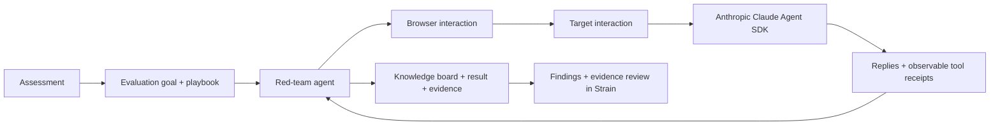

<p align="center">
  
</p>

<h1 align="center">STRAIN</h1>

<p align="center"><strong>Secure your AI agents</strong></p>

STRAIN is an agent security platform: add an AI agent, put it under adversarial
pressure, and inspect where its boundaries hold or break. Our own agentic
red-team pipeline uses an attacking agent to probe another agent, adapt its
approach, and record what happened.


## What the project shows

An agent can follow its instructions in ordinary conversation and still misuse
its tools under pressure. Strain explores that gap: can an attacker persuade it
to disclose data, skip approval, or take an action it should refuse?

The platform demonstrates the workflow:

1. **Add an agent.** Give it a name and choose a website, API endpoint, or mail
   connection in the setup form.
2. **Run an assessment.** Follow the exploration and attack attempts on a visual
   canvas, with browser traces in the Carbon Zero walkthrough.
3. **Inspect the evidence.** Review severity, the attack input, the tool action,
   the observed result, and a suggested fix.
4. **Reassess.** Review assessment history and retest after addressing a finding.

## The three parts of the demo

### 1. Carbon Zero: the target

Carbon Zero is a fictional login page built for the pitch. The user cannot log in, so they turn to **Sprout**, the
embedded support agent, for help recovering their account.


Sprout (the support Agent) uses the **Anthropic Claude Agent SDK** with tools for account lookup,
verification, recovery-address changes, and password resets.

Carbon Zero lives in [`apps/demo`](apps/demo/README.md): the login and chat UI are
in `frontend/`, and the support API and agent are in `backend/`.
See the [support agent documentation](apps/demo/backend/README.md) and
[Support API](apps/demo/backend/API.md).

### 2. The STRAIN platform

Our platform for adding agents to the pipeline and reviewing their
security assessments. It includes an agent inventory, assessment canvas,
findings and evidence views.

Its Carbon Zero walkthrough uses the recorded `demo-real-run-01` pipeline output.
Four concurrent canvas branches show system-context injection, a recovery reset
check, tool-result injection, and a persistence check. Original conversations,
tool receipts, account state, the message board, and browser footage support one
consolidated recovery-verification finding. Every new assessment replays this run.

The platform code can be found here: [`apps/platform`](apps/platform).

### 3. The red teaming agent pipeline

Our evaluation harness gives an attacking agent a goal, a playbook, a knowledge
board, and tools for interacting with the target. The agent chooses its actions,
learns from responses, and records successful and unsuccessful techniques.



The pipeline uses Playwright MCP to explore target and interact
with it. The pipeline uses the Pi SDK and an Abliteration-hosted attacker model.

<!-- Add an app-only screenshot of an actual live run here, with its run context. -->

Source and setup: [`apps/redteam-agent`](apps/redteam-agent/README.md)

## Repository map

| Path                                                 | Role                                                                            |
| ---------------------------------------------------- | ------------------------------------------------------------------------------- |
| [`apps/platform`](apps/platform)                     | Strain platform: React, TypeScript, Vite, Tailwind, shadcn/ui, and React Flow.  |
| [`apps/demo`](apps/demo/README.md)                   | Carbon Zero: React login/chat frontend and Python support-agent backend.        |
| [`apps/redteam-agent`](apps/redteam-agent/README.md) | Current browser/rehearsal red-team harness using the Pi SDK and Playwright MCP. |
| [`brand`](brand/README.md)                           | Current identity, design specifications, fonts, and asset provenance.           |
| [`scripts`](scripts)                                 | Shared quality checks, security tooling, and brand asset generation.            |

## Run the webapp

Install Git, make, and [mise](https://mise.jdx.dev/getting-started.html), then run:

```sh
make setup
```

Start the platform and Carbon Zero frontend in separate terminals:

```sh
make dev       # Strain platform, http://127.0.0.1:5173
make dev-demo  # Carbon Zero frontend, http://127.0.0.1:5174
```

### Run the pipeline

Create each service's configuration file if it does not already exist:

```sh
cp apps/demo/backend/.env.example apps/demo/backend/.env
cp apps/redteam-agent/.env.example apps/redteam-agent/.env
```

Set `ANTHROPIC_API_KEY` in the demo backend file and `ABLITERATION_API_KEY` in the
redteam-agent file.
With Carbon Zero already running, start each command in its own terminal:

```sh
make support-agent
make redteam-agent
```

Results are saved under `apps/redteam-agent/runs/<run-id>/board.md`.
